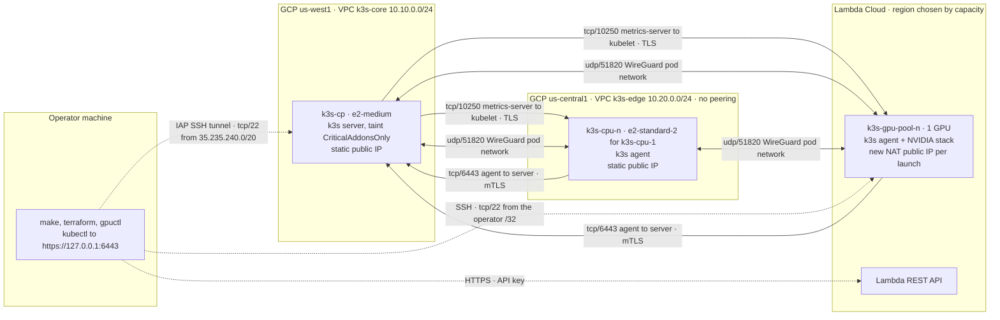
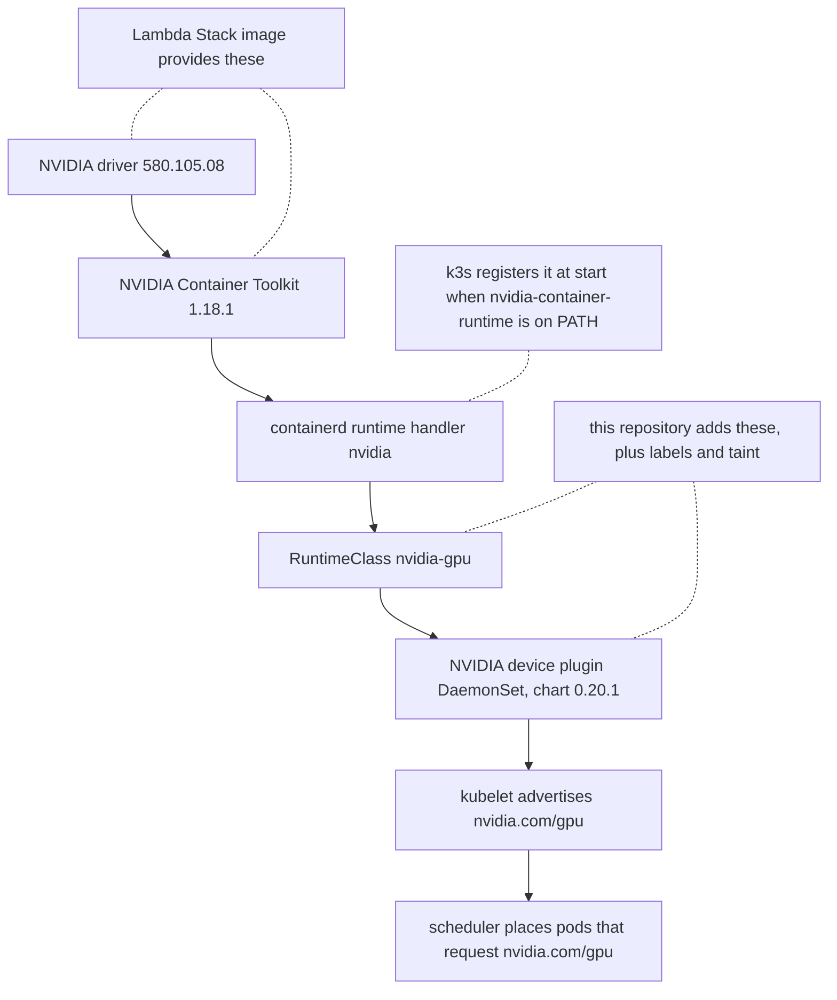

# Hybrid GPU Kubernetes cluster: k3s on GCP, GPU workers on Lambda Cloud

A lightweight Kubernetes control plane on a GCP VM, a pool of GCP CPU workers in a second VPC, and
GPU workers rented by the hour from Lambda Cloud, all joined into one k3s cluster over the public
internet. Pod traffic between nodes is encrypted with WireGuard, and every cluster port admits only
the other nodes' `/32` addresses. Terraform, a small Python reconciler (`gpuctl`) and shell scripts
create and destroy everything, driven from `make`.

This brief covers the architecture, the decisions and their trade-offs, the security design, and how
to reproduce and verify the build. Numbers in it are measured on live runs (2026-10-21 and
2026-10-22) unless marked as list prices.

| Document | Content |
|---|---|
| [docs/adr/0001-k3s-not-kubeadm.md](docs/adr/0001-k3s-not-kubeadm.md) | k3s, not kubeadm or RKE2 |
| [docs/adr/0002-network-k3s-wireguard-native.md](docs/adr/0002-network-k3s-wireguard-native.md) | Cross-cloud network: k3s `wireguard-native` with external IPs |
| [docs/adr/0003-terraform-three-stacks.md](docs/adr/0003-terraform-three-stacks.md) | Terraform in three stacks plus bootstrap; Lambda owned by Python |
| [docs/adr/0004-gpu-nodes-as-cattle-spec-reconciler.md](docs/adr/0004-gpu-nodes-as-cattle-spec-reconciler.md) | GPU nodes as cattle, reconciled from a spec |
| [docs/adr/0005-gpu-device-plugin-and-runtimeclass.md](docs/adr/0005-gpu-device-plugin-and-runtimeclass.md) | Device plugin with our own RuntimeClass on an admin label |
| [docs/adr/0006-ip-allowlist-vs-identity-network.md](docs/adr/0006-ip-allowlist-vs-identity-network.md) | IP allow-lists now; when to move to an identity-based network |
| [docs/threat-model.md](docs/threat-model.md) | Assets, trust boundaries, threats, residual risks |
| [docs/runbook.md](docs/runbook.md) | Operations, scaling, break-glass, teardown, demo day, measured timings |
| [docs/p2-roadmap.md](docs/p2-roadmap.md) | Deferred work, with why and how |

## Architecture



Three kinds of cluster traffic cross the internet, and each inbound rule admits only the peers' `/32`s:

- **tcp/6443, agent to server:** the Kubernetes API and the k3s supervisor websocket, mutual TLS. API
  server to kubelet calls (`logs`, `exec`) ride the same agent-initiated connection.
- **udp/51820, every node to every node:** flannel's `wireguard-native` backend, carrying all
  cross-node pod traffic (full mesh, 25 s keepalive).
- **tcp/10250, control plane to agents:** metrics-server scraping kubelets over TLS.

The operator never reaches 6443 directly: `kubectl` goes through an IAP SSH tunnel to `127.0.0.1:6443`
on the control plane, and GCP shells go through IAP and OS Login.

### Nodes

| Node | Where | Size and image | Role |
|---|---|---|---|
| `k3s-cp` | GCP `us-west1-b`, VPC `k3s-core` | e2-medium, Ubuntu 24.04, 20 GB pd-balanced, Shielded VM | k3s server; taint `CriticalAddonsOnly=true:NoExecute`, no workloads |
| `k3s-cpu-<n>` | GCP `us-central1-a`, VPC `k3s-edge` (no peering with `k3s-core`) | `k3s-cpu-1` e2-standard-2, added workers e2-small; same image and hardening | k3s agent; 1 by default, scaled from a Terraform inventory |
| `k3s-gpu-<pool>-<n>` | Lambda Cloud, first (type, region) in the spec with capacity | spec type `gpu_1x_a6000`, fallbacks `gpu_1x_a10`, `gpu_1x_a100`; image family `lambda-stack-22-04` | k3s agent with GPU; 1 by default, reconciled from [lambda/gpu-nodes.yaml](lambda/gpu-nodes.yaml) |

The CPU workers sit in their own VPC on purpose: they reach the control plane over the same public
path and the same kind of `/32` rules as the Lambda nodes, so "two CPU nodes can talk" is a real
cross-network test. On both live days the only 1-GPU type Lambda had in stock was `gpu_1x_a10`, so
every GPU measurement below is on an A10 that the fallback list selected.

Pinned versions: k3s `v1.36.5+k3s1` (`install.sh` from the release tag, never `get.k3s.io`), Terraform
google provider `= 8.7.0` with committed lock files, NVIDIA device plugin chart `0.20.1`; every
container image in `k8s/` is pinned by `@sha256:` digest.

### One owner per resource

| Resource | Owner |
|---|---|
| Everything on GCP, including the firewall rules that follow the GPU nodes | Terraform: [infra/bootstrap](infra/bootstrap/), [infra/base](infra/base/), [infra/workers](infra/workers/), [infra/gpu-access](infra/gpu-access/) |
| Lambda instances, the Lambda global rules and the `k3s-gpu-<region>` rulesets | `gpuctl` ([lambda/gpuctl](lambda/gpuctl/)) against the Lambda REST API |
| OS settings, host firewall, k3s install on each node | [node/](node/), run over SSH by the scripts |
| Objects in the cluster | manifests and Helm values under [k8s/](k8s/) |
| Orchestration | [Makefile](Makefile) and [scripts/](scripts/) |

### Decisions

| Decision | Chosen | Main alternatives | ADR |
|---|---|---|---|
| Distribution | k3s | kubeadm, RKE2, GKE | [0001](docs/adr/0001-k3s-not-kubeadm.md) |
| Cross-cloud network | k3s `wireguard-native` + `--node-external-ip` (option A) | host WireGuard hub-spoke (B), Tailscale (C), kubeadm + Cilium (D) | [0002](docs/adr/0002-network-k3s-wireguard-native.md) |
| Infrastructure as code | Terraform `bootstrap`, `base`, `workers`, `gpu-access`; Lambda in Python | one stack; community Lambda provider | [0003](docs/adr/0003-terraform-three-stacks.md) |
| GPU node lifecycle | disposable nodes reconciled from a YAML spec, no local state | pet nodes, Terraform, cluster-autoscaler | [0004](docs/adr/0004-gpu-nodes-as-cattle-spec-reconciler.md) |
| GPU enablement | device plugin + RuntimeClass `nvidia-gpu` on an admin label | GPU Operator, `--default-runtime=nvidia` | [0005](docs/adr/0005-gpu-device-plugin-and-runtimeclass.md) |
| Peer authentication | `/32` allow-lists in three places, rebuilt by `make sync-peers` | identity overlay (WireGuard keys, Tailscale) | [0006](docs/adr/0006-ip-allowlist-vs-identity-network.md) |

## Networking and security

### Three lines of defence

1. **Cloud firewalls.** GCP VPC rules and Lambda firewall rules. Every source is a single `/32` except
   Google's IAP range `35.235.240.0/20` for SSH to the GCP VMs; GCP rules target service accounts and
   log every match. Lambda's account-wide rules allow only the operator's SSH `/32`; each region's
   ruleset `k3s-gpu-<region>` is attached at launch and rewritten by `sync-peers`. Anything not listed
   is denied. A repository test fails if the any-IPv4 CIDR appears in any tracked file, and check B6
   lists every live rule.
2. **Host firewall `k3s_guard`.** A separate nft table loaded by our oneshot unit `k3s-guard.service`,
   ordered before k3s and required by it, so k3s never runs without it. Chains run at priority -5, so
   a drop is final but an accept never overrides k3s's own rules; Ubuntu's `nftables.service` is not
   used because it flushes the whole ruleset ([node/guard/](node/guard/)).
   - `k3s-cp`: tcp 6443 and 10250 only from `lo`, `cni0` and the `k3s_peers` set, else dropped.
     `sync-peers` replaces the set and persists it, so a reboot restores the last list.
   - Agents: tcp 10250 only from `lo`, `cni0` and `<cp_ip>`.
   - Every node: pod traffic (`10.42.0.0/16`) to `169.254.169.254` is dropped except DNS on port 53,
     so a pod cannot read GCE metadata or a service-account token.
3. **k3s and Kubernetes.** mTLS on 6443; CA-pinned `K10…` join tokens valid 15 minutes, piped from
   the control plane straight to the node and deleted once it is Ready; Secrets encrypted at rest; Pod
   Security Admission `restricted` by default (`kube-system` is exempt, and in the core build
   `nvidia-device-plugin` is the only namespace labelled `privileged`; the optional monitoring stack
   adds `monitoring-host`, privileged for the hostPath reads of node-exporter and the DCGM exporter);
   audit log at `Metadata` level; NodeRestriction; default-deny NetworkPolicy in `hello`;
   `protect-kernel-defaults` with the kubelet sysctls written first.

Underneath: Shielded VM (secure boot, vTPM, integrity monitoring, set explicitly), service accounts
with no IAM role bindings, OS Login with project SSH keys blocked, SSH to GCP only through IAP,
`can_ip_forward = false`. On Lambda, JupyterLab and Docker are disabled and the image is never
`apt full-upgrade`d.

### What is encrypted, and what is exposed

| Traffic | Protection | Reachable from |
|---|---|---|
| Pod to pod across nodes | WireGuard (flannel `wireguard-native`) | udp/51820 from peer `/32`s only |
| Agent to API server, tcp/6443 (also API server to kubelet `logs`/`exec`) | Kubernetes mutual TLS | peer `/32`s, plus `<cp_ip>` itself (hairpin) |
| metrics-server to kubelet, tcp/10250 | TLS, kubelet authentication and authorisation | `<cp_ip>/32` only |
| Operator `kubectl` | IAP tunnel (Google TLS) with Kubernetes TLS inside | IAP after Google IAM checks; nothing listens publicly for it |
| SSH to GCP VMs | IAP plus OS Login | `35.235.240.0/20` only |
| SSH to Lambda nodes | SSH keys | the operator's `/32` only |

**The stated cost of this design:** tcp/6443 and tcp/10250 cross the public internet outside
WireGuard, protected by TLS and by `/32` rules at two layers rather than by the tunnel.
[ADR-0002](docs/adr/0002-network-k3s-wireguard-native.md) explains why, and when to switch to a design
that hides them.

### Known issues of the network design, and what was measured

| Issue | Handling | Measured |
|---|---|---|
| The `kubernetes` Service endpoint is `<cp_ip>`, so pods on `k3s-cp` hairpin through GCP's 1:1 NAT | `fw-cp-allow-self` (`<cp_ip>/32`, 6443 and 10250); both control-plane IPs in `k3s_peers` | hairpinned connections arrive with `<cp_ip>` as source; CoreDNS Ready about 3 s after recreation; 632 accepts, 0 drops |
| With `--flannel-external-ip`, metrics-server prefers ExternalIP | bundled metrics-server disabled; ours pinned to `k3s-cp` with `ExternalIP,InternalIP,Hostname` | A3 and C6 pass; agents accept 10250 only from `<cp_ip>` |
| NIC MTUs differ (GCP 1460, Lambda 1500) | every NIC set to `UNDERLAY_MTU` 1460 before k3s starts, so every tunnel is 1380 | 1352-byte ping with DF passes and 1353 fails on every pair of the 3-node matrix |
| Lambda's public IP is NAT and new at every launch | `gpuctl` applies `gpu-access` and runs `sync-peers` before the join | NIC holds a private `/20`; egress IP equals the API's IP; handshakes through NAT on both sides |
| Lambda rulesets attach only at launch | `gpuctl` ensures `k3s-gpu-<region>` before each launch and PATCHes it later | from the operator, the GPU node's 10250, 6443, 443 and 8888 time out; only 22 answers |
| NetworkPolicy on the WireGuard path | kube-router enforces it | C8: allowed from `nettest`; rejected elsewhere (curl exit 7: kube-router rejects instead of dropping) |
| GCE's `60-gce-network-security.conf` sets `ip_forward=0` | `/etc/sysctl.d/90-kubelet.conf` sorts after it and sets 1, plus redirect and source-route hardening | before the fix, `sysctl --system` on a re-run cut pod traffic on GCP nodes |

### Credentials

| Credential | Lives in | Never in |
|---|---|---|
| Lambda API key (account-wide; Lambda keys cannot be scoped) | operator's `.env`, mode 600, git-ignored | the repo, nodes, `user_data`, Terraform, command lines, child process environments |
| GCP credentials | operator's `gcloud` login and ADC | the repo, nodes |
| k3s server token | `k3s-cp` only | anywhere else |
| Join tokens | created per node with a 15-minute TTL, piped to the node, deleted when it is Ready | the operator's disk, variables or arguments |
| kubeconfig (cluster admin) | `~/.kube/hybrid-gpu.yaml`, mode 0600; removed by `make down` | the repo; never printed |
| Terraform state | versioned GCS bucket `<GCP_PROJECT>-k3s-tfstate`, one prefix per stack | the repo |

`.env` is sourced as shell, so whoever can write it runs code as the operator; the scripts refuse it
unless it is mode 600. gitleaks runs in pre-commit and in `make lint` over the full history, with
extra rules for k3s `K10` tokens and the Lambda key format.

### Observability

What exists today: the API server audit log on `k3s-cp`; firewall rule logging on every GCP rule;
`k3s_guard` accept and drop counters; `/var/log/gpu-audit.txt` on each GPU node; `gpuctl status`
drift between Lambda, the cluster, the `gpu-access` state and `k3s_peers`; metrics-server
(`kubectl top`); and the evidence of every `make verify` run. GCP's managed Prometheus and Cloud
Logging are not used: they need IAM roles on the node service accounts and a credential on the
Lambda hosts. Central logs, alerting and long-term metrics are in the [P2 roadmap](docs/p2-roadmap.md).
An optional stretch, separate from this core, adds a port-forward-only monitoring stack
(`k8s/monitoring/`, `make monitoring`) and an operator-side autoscaling demo.

## GPU enablement



- The driver and the Container Toolkit come with Lambda's `lambda-stack-22-04` image (measured: driver
  580.105.08, CUDA 13.0, toolkit 1.18.1, `nvidia-container-runtime` at `/usr/bin`). We add nothing to
  them: no NVIDIA apt repository, no `apt full-upgrade`, no `nvidia-ctk runtime configure`.
- k3s registers the containerd handler `nvidia` when it starts. `join-node.sh` checks containerd's
  generated config and restarts `k3s-agent` once if the section is missing.
- We add RuntimeClass `nvidia-gpu` ([k8s/system/nvidia-gpu-runtimeclass.yaml](k8s/system/nvidia-gpu-runtimeclass.yaml)):
  it schedules only onto nodes with the admin-applied label
  `node-restriction.kubernetes.io/accelerator=nvidia` and tolerates the GPU taint. NodeRestriction
  forbids a node to set that label on itself.
- The device plugin is Helm chart `0.20.1`, image pinned by digest, running under `nvidia-gpu`, with
  its tolerations written out ([k8s/system/nvdp-values.yaml](k8s/system/nvdp-values.yaml)).
- GPU nodes register with `nvidia.com/gpu.present=true`, `gpu-type=<model>` and the taint
  `nvidia.com/gpu=present:NoSchedule`; GPU pods set `runtimeClassName: nvidia-gpu` and
  `limits: {nvidia.com/gpu: 1}`, run as UID 1000 under PSA `restricted`, and never set
  `NVIDIA_VISIBLE_DEVICES`.

Measured on the A10: `nvidia-smi` as a non-root pod, `vectoradd` `Test PASSED`, a second GPU request
Pending with `Insufficient nvidia.com/gpu`, and `nvidia.com/gpu: 1` in Allocatable about 20 s after
the plugin registered. Not done on purpose: `--default-runtime=nvidia` and the GPU Operator; see
[ADR-0005](docs/adr/0005-gpu-device-plugin-and-runtimeclass.md), including the residual risk of an
image that sets `NVIDIA_VISIBLE_DEVICES=all`.

## Reproduce

Prerequisites (details in the [runbook](docs/runbook.md#prerequisites)):

- a GCP project with billing; the operator needs `roles/compute.osAdminLogin`,
  `roles/iap.tunnelResourceAccessor`, `roles/iam.serviceAccountUser` on the two service accounts, and
  rights to create the resources;
- a Lambda Cloud account, an API key, and an SSH public key uploaded to Lambda;
- terraform >= 1.9, gcloud, kubectl, helm, python3 >= 3.11, jq, gitleaks, kubeconform, bash >= 4.1
  and flock (on macOS: `brew install bash flock`);
- `gcloud auth login` and `gcloud auth application-default login`.

```bash
cp .env.example .env && chmod 600 .env  # GCP_PROJECT, LAMBDA_API_KEY, LAMBDA_SSH_KEY_NAME,
                                        # SSH_PRIVATE_KEY_PATH; OPERATOR_IP optional
make venv        # .venv with the Python tooling
make lint        # pre-commit hooks, gitleaks over history, terraform validate/test, pytest
make init        # once: state bucket and GCP APIs (a few cents of storage; VM billing starts with make up)
make up          # base, k3s-cp, kubeconfig, tunnel, CPU workers, system components, workloads
make gpu-plan    # what gpu-apply would launch, and the hourly cost at live prices
make gpu-apply   # launch, firewall, join and label the GPU node(s); asks first
make verify      # checks A-D into verification/<timestamp>/
make gpu-down    # terminate every GPU node; then make gpu-status shows none
make down        # GPU nodes, workers, base; the state bucket is kept
```

`make help` lists every target. Every step can be re-run: a second `make up` on a running cluster
took 92 s and changed nothing (no Terraform change, no k3s restart, guard rules untouched). Applies
by `make up` and the CPU pool targets show their plan and ask; under `AUTO_APPROVE=1` they refuse
any destroy or replace of `k3s-cp` or an undrained worker. Two exceptions: `gpuctl` applies the
`gpu-access` stack without a prompt, inside the `gpu-apply` or `gpu-down` that asked first
([ADR-0003](docs/adr/0003-terraform-three-stacks.md)), and `make down` destroys everything after one
question, which `AUTO_APPROVE=1` also skips. Never export `AUTO_APPROVE` in a shell. Scaling,
break-glass access and the teardown details are in the [runbook](docs/runbook.md).

## Verification

`make verify` runs groups A-D; `make verify RESILIENCE=1` adds E ([scripts/verify.sh](scripts/verify.sh),
check functions in [scripts/lib/checks.sh](scripts/lib/checks.sh)):

| Group | What it proves |
|---|---|
| A, cluster | `get nodes -o wide`, `describe node` for every node; metrics-server and CoreDNS on `k3s-cp`; every node's flannel `public-ip` equals its ExternalIP |
| B, connectivity | an N×N matrix from a probe on every node to an echo on every node (pod IP, Service DNS, MTU 1352 passes and 1353 fails); a capture on `k3s-cp` in which a marker never appears in clear text and peers use only udp/51820, tcp/6443, tcp/10250 and ICMP; WireGuard handshakes under 3 minutes old; one capped iperf3 run; negative tests (6443/10250 from the operator, metadata from pods, DNS works, guard counters); every firewall source a `/32` or IAP |
| C, hello world | rollout; `hello world` from a pod on another node and through `port-forward`; QoS `Guaranteed`; cgroup `memory.max = 67108864` and `cpu.max = 10000 100000`; `kubectl top`; an OOMKilled pod (exit 137) and a throttled pod; NetworkPolicy allows `nettest` and rejects another namespace |
| D, GPU | GPU audit, containerd's `nvidia` section, the RuntimeClass; `nvidia.com/gpu` in Capacity and Allocatable; device plugin registered; `nvidia-smi` in a pod; `vectoradd` `Test PASSED`; a pod asking one GPU too many stays Pending. SKIP, not FAIL, without a GPU node |
| E, resilience | E1 reboots `k3s-cpu-1` (NotReady, Ready, B1 again); E2 replaces the GPU node with `gpuctl down` and `gpuctl apply`, then D1-D6 and B1; E3 forges a stale `gpu-access` rule that `gpuctl status` must report and `gpuctl apply` must remove |

Each run writes `verification/<YYYY-MM-DDTHHMM-0700>/`: one numbered file per check, starting with the
commands it ran, and a `SUMMARY.md` with PASS, FAIL or SKIP. Output passes a redaction filter
(tokens, kubeconfig keys, private keys, the Lambda key; the operator's IP becomes `<operator_ip>` and
the GCP project id `<GCP_PROJECT>`, in any case), every check is time-bounded, an interrupt runs each
check's cleanup, and gitleaks scans the run.

| Run | Result | Time |
|---|---|---|
| A-C, no GPU node (2026-10-21) | 18 PASS, D SKIP | 258-263 s |
| A-D, one A10 (2026-10-21) | 24/24 PASS | 412 s |
| `RESILIENCE=1` on a cluster rebuilt from scratch (2026-10-22) | 27/27 PASS, 0 skipped, gitleaks clean | 21m54s |

The committed evidence will be `verification/final/SUMMARY.md`. Task 24 produces it from a final
from-scratch run (`make down`, `make up`, `make gpu-apply`, `make verify RESILIENCE=1`) and promotes
it with `OPERATOR_IP=$(curl -s https://checkip.amazonaws.com) make promote-verify
RUN=verification/<ts>`, which copies the run to a staging directory, scans every file with gitleaks
and for the GCP project id (the environment's and `.env`'s), and only then replaces
`verification/final/`. It also fails on the operator's IP, but only when `OPERATOR_IP` is set in the
caller's environment, as above; it never looks the IP up itself. A
`grep -r "$(curl -s https://checkip.amazonaws.com)" verification/final` that prints nothing is the
required last step before the copy is committed ([runbook](docs/runbook.md#verification)).
To re-run on a live cluster: `make tunnel` if it is not running, then `make verify`, and compare the
new `SUMMARY.md` with the committed one.

## Live demo

The demo runs live from the operator's machine with the screen shared; viewers need no access.
`make demo` (added by Task 25) runs the same check functions as `make verify`, chapter by chapter: it
prints each step's title and command, runs it through the same redaction filter, and waits for Enter.

| Chapter | Content | Checks |
|---|---|---|
| 1 | Architecture: this diagram, `kubectl get nodes -o wide`, node summary, system pods | A1-A3 |
| 2 | Security: firewall inventory (all `/32`), 6443/10250 time out from the laptop, the wire shows only WireGuard for pod traffic, metadata blocked | B6, B5, B2 |
| 3 | Cross-node connectivity matrix | B1 |
| 4 | Hello world: cross-node curl, port-forward, QoS and cgroup values, OOMKilled, throttling, NetworkPolicy | C2-C5, C7, C8 |
| 5 | GPU: advertised GPU, `nvidia-smi` pod, `vectoradd`, oversubscription Pending | D2, D4-D6 |
| 6 | Spec-driven scaling: `cpu-scale` to 2 and back to 1 (guarded), `gpu-plan` with a changed count (with the committed budget, a second GPU node is refused: the plan is printed, then `plan refused`; see [Cost](#cost)) | - |
| 8 | Teardown: the `make down` plan, or the real teardown | - |

Chapter 7 (autoscaling) belongs to the optional stretch and is not part of the core demo.

Task 25 also adds the other demo targets: `make demo CHAPTERS=1,2,4,5` for a shorter slot,
`make demo-replay CHAPTER=n` to print a chapter's recorded output if a live step fails,
`make demo-reset` to remove what a run creates, and `make preflight` to check tools, logins, the
operator IP and GPU stock beforehand. Until then the [demo-day checklist](docs/runbook.md#demo-day-checklist)
lists the commands each one automates. Task 25 adds the per-chapter timings
after the rehearsals; the measured building blocks are `make cpu-scale N=2` 156 s, back to 1 in
179-182 s, and `make gpu-apply` 5m43s-9m41s, which is why the GPU node is launched about 30 minutes
ahead ([demo-day checklist](docs/runbook.md#demo-day-checklist)).

## Cost

GCP rates are on-demand list prices gathered during the design research; Lambda prices are the
API's live prices, which `gpu-plan` reads at plan time.

| Item | Rate | Per day |
|---|---|---|
| `k3s-cp`, e2-medium | $0.0335/h | $0.80 |
| `k3s-cpu-1`, e2-standard-2 | $0.0670/h | $1.61 |
| 2 static IPs (in use) | $0.005/h each | $0.24 |
| 2 × 20 GB pd-balanced | about $0.10/GiB-month | $0.13 |
| **GCP, cluster idle** | | **about $2.8** (about $1.6 with an e2-small worker, $0.0168/h) |
| Internet egress | $0.12/GiB after the first GiB (Premium tier); iperf3 capped at 50 MB per run | cents |
| `gpu_1x_a10` (the type in stock on both days) | $1.29/h, billed while it exists | $31 if forgotten |
| `gpu_1x_a6000` / `gpu_1x_a100` (no stock on either day) | $1.09/h / $1.99/h | |

Measured GPU spend: the 2026-10-21 session cost about $0.25 for 11 minutes; the 2026-10-22
`RESILIENCE=1` run kept one A10 for about 38 minutes, including the E2 replacement, for about $0.8.
The per-day GCP figure is the sum of the hourly rates above times 24, plus the disks' monthly rate
divided by 30.

The largest cost risk is a forgotten GPU node: Lambda has no stopped state. The guards are
`budget_usd_per_hour` (3.0, checked at live prices, new nodes priced at their pool's most expensive
candidate, so with the A100 fallback listed it admits one GPU node in total) and `max_nodes` (3) in
[lambda/gpu-nodes.yaml](lambda/gpu-nodes.yaml); automatic
termination of a node that fails to join; `make gpu-down` after every GPU session with `make
gpu-status` to confirm; and `make down`'s last step, which fails while Lambda still lists a GPU node
of this cluster.

## Limitations and next steps

- **Single control plane.** k3s's multicloud mode does not support embedded etcd; losing `k3s-cp`
  means rebuilding the cluster.
- **Control-plane ports cross the internet** outside WireGuard, protected by TLS and `/32`s
  ([ADR-0002](docs/adr/0002-network-k3s-wireguard-native.md)).
- **Peers are authenticated by IP.** Every node change rewrites three allow-lists from the operator's
  machine; this does not suit autoscaling or large fleets
  ([ADR-0006](docs/adr/0006-ip-allowlist-vs-identity-network.md)).
- **GPU isolation relies on scheduling.** A pod under the NVIDIA runtime whose image sets
  `NVIDIA_VISIBLE_DEVICES=all` sees all GPUs; the fix is CDI plus an admission policy.
- **IP forwarding on Lambda hosts** routes between all interfaces with no provider-side
  anti-spoofing: a host on the same L2 segment could reach any pod or ClusterIP Service through a GPU
  host, past both allow-list layers, with NetworkPolicy as the only remaining control. A guard
  forward rule would close it; default-deny NetworkPolicies narrow it meanwhile.
- **One shared admin credential**, not tied to a person.
- **Third-party GPU hosts:** Lambda has root on them, and each new host key is trusted on first use.
- **Bundled containerd 2.3.4** is likely affected by two medium-severity DoS advisories; upgrade with
  the k3s release that fixes it.

The [P2 roadmap](docs/p2-roadmap.md) expands each item with why it matters and how it would be built;
the [threat model](docs/threat-model.md) lists the residual risks in full.
