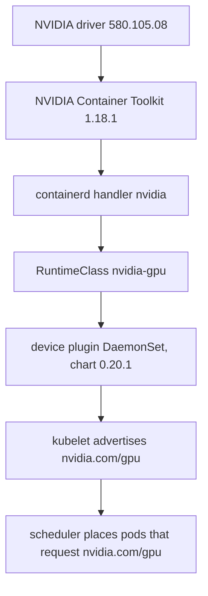

# GPU enablement: NVIDIA device plugin with our own RuntimeClass on an admin label

## Context and Problem Statement

GPU pods need, from the bottom up: the NVIDIA driver, the NVIDIA Container Toolkit, a containerd
runtime handler that injects the GPU, a way for pods to select that handler, a device plugin that
advertises `nvidia.com/gpu` to the kubelet, and scheduling that keeps everything else off the GPU
nodes. Lambda's `lambda-stack-22-04` image already provides the bottom two layers (measured: Ubuntu
22.04.5, kernel `6.8.0-1046-nvidia`, driver 580.105.08 with CUDA 13.0, NVIDIA Container Toolkit
1.18.1, `nvidia-container-runtime` at `/usr/bin` in `mode = auto`). k3s registers a containerd
handler `nvidia` when it finds that binary on its PATH at start, and creates a cluster-wide
RuntimeClass `nvidia` with no node selector.

How should the remaining layers be set up so that only GPU pods see GPUs, a node cannot opt itself
into GPU work, and nothing on the host is reconfigured that the next Lambda image might change?

## Decision Drivers

- Use the driver and toolkit the image ships; install nothing NVIDIA on the host.
- Only pods that ask for a GPU get the NVIDIA runtime; other pods on a GPU node do not.
- A node must not be able to attract GPU workloads by labelling itself.
- Small and inspectable: every piece is a file in this repository.

## Considered Options

- NVIDIA device plugin (Helm) plus our own RuntimeClass `nvidia-gpu` scoped by an admin-only label
- NVIDIA GPU Operator
- `--default-runtime=nvidia` on the GPU nodes, plus the device plugin
- The device plugin with k3s's own RuntimeClass `nvidia`

## Decision Outcome

Chosen option: **device plugin plus our own RuntimeClass `nvidia-gpu`**, because it adds exactly the
missing layers, keeps the NVIDIA runtime opt-in per pod, and binds GPU scheduling to a label only an
administrator can set.

- **Layers 1-2 (Lambda image).** Nothing added: no NVIDIA apt repository, no `apt full-upgrade`, no
  `nvidia-ctk runtime configure` (k3s does not read the file it edits).
- **Layer 3 (k3s).** The `nvidia` handler appears in k3s's generated containerd config. After the
  join, `join-node.sh` greps for it and restarts `k3s-agent` once if it is missing, since detection
  runs only at start ([scripts/join-node.sh](../../scripts/join-node.sh)).
- **Layer 4 (ours).** RuntimeClass `nvidia-gpu`, handler `nvidia`, whose scheduling adds the node
  selector `node-restriction.kubernetes.io/accelerator: nvidia` and the toleration for the GPU taint
  ([k8s/system/nvidia-gpu-runtimeclass.yaml](../../k8s/system/nvidia-gpu-runtimeclass.yaml)).
  NodeRestriction stops a kubelet from setting `node-restriction.kubernetes.io/` labels on its own
  node, so only `join-node.sh`, with the admin kubeconfig, applies that label after the node is Ready.
- **Layer 5 (ours).** Helm chart `nvidia-device-plugin` `0.20.1`, image pinned by digest, running
  under `nvidia-gpu`, tolerations written out (`CriticalAddonsOnly`, the GPU taint) instead of
  relying on chart defaults, in namespace `nvidia-device-plugin`, the only namespace with PSA
  `privileged` (it needs hostPath) ([k8s/system/nvdp-values.yaml](../../k8s/system/nvdp-values.yaml)).
- **Node registration.** GPU agents register with the labels `nvidia.com/gpu.present=true` (the
  chart's node affinity) and `gpu-type=<model>`, and the taint `nvidia.com/gpu=present:NoSchedule`.
  On the host, `node-bootstrap.sh` first records an audit (`nvidia-smi`, OS, kernel, runtime path and
  mode, NIC and MTU before any change) in `/var/log/gpu-audit.txt`, then disables `lambda-jupyter`
  and Docker.
- **Pods.** GPU pods set `runtimeClassName: nvidia-gpu` and `limits: {nvidia.com/gpu: 1}`, run as
  UID 1000 under PSA `restricted`, and never set `NVIDIA_VISIBLE_DEVICES`.

### Consequences

- Good, because a CPU pod on a GPU node runs under runc and sees no GPU; the NVIDIA runtime is chosen
  per pod.
- Good, because a compromised or misconfigured node cannot attract GPU pods: the selector is on a
  label only an administrator can set.
- Good, because nothing on the Lambda host is reconfigured beyond disabling two services; a new image
  version brings its own matched driver and toolkit.
- Bad, because of a **residual risk**: any pod that runs under the `nvidia` handler and whose *image*
  sets `NVIDIA_VISIBLE_DEVICES=all` sees every GPU on the node, whether or not it requested one. The
  taint, the admin label and the RuntimeClass scheduling limit where such a pod can run, not what it
  sees. The fix is CDI mode for the device plugin plus a ValidatingAdmissionPolicy that allows the
  `nvidia-gpu` RuntimeClass only in GPU namespaces ([P2 roadmap](../p2-roadmap.md)).
- Bad, because k3s's own RuntimeClass `nvidia` still exists and has no node selector. A pod that
  names it can land on a CPU node and fail to start there; it cannot gain a GPU on a CPU node. The
  admission policy above would also cover it.
- Bad, because we track the chart and the image's toolkit ourselves; the GPU Operator would do that
  for us.

### Confirmation

Measured on a `gpu_1x_a10` (2026-10-21 and in the 2026-10-22 rehearsal):

- The device plugin ran only on the GPU node (1/1), logged `Registered device plugin for
  'nvidia.com/gpu' with Kubelet` with the NVML discovery strategy, and `nvidia.com/gpu: 1` appeared in
  Capacity and Allocatable about 20 s after registration, so check D2 retries for up to 90 s.
- `gpu-smoke` ran `nvidia-smi` as UID 1000 under PSA `restricted` and printed the A10 and the driver
  version, so the `gpu-test` namespace did not need to drop to `baseline`.
- `vectoradd` (CUDA 12.5 sample) printed `Test PASSED`; the CUDA 12.8.1 base image ran on the CUDA 13.0
  driver.
- With one GPU held by a running pod, `gpu-overflow` stayed Pending with `Insufficient nvidia.com/gpu`.
- With Docker and `lambda-jupyter` disabled, the GPU pods still succeeded.

These are verification checks D1-D6; they ran again on the replacement node in E2.

## Pros and Cons of the Options

### Device plugin plus our RuntimeClass (chosen)

- Good, because it is the minimum on top of what the image and k3s already do.
- Bad, because the isolation gap above remains until CDI and an admission policy are added.

### NVIDIA GPU Operator

- Good, because it also brings GPU Feature Discovery, DCGM, MIG management and CDI.
- Bad, because it manages a driver and toolkit the image already has (they would have to be turned
  off in its values), and its validators and daemons add several privileged DaemonSets to a cluster
  with one GPU node.
- Bad, because it is a large moving part for the reviewer to trust; it is listed in P2 for fleets.

### `--default-runtime=nvidia`

- Good, because no pod needs a `runtimeClassName`.
- Bad, because every pod on the node, system DaemonSets included, runs under the NVIDIA runtime;
  together with an image that sets `NVIDIA_VISIBLE_DEVICES=all`, any pod sees the GPUs.

### Device plugin with k3s's RuntimeClass `nvidia`

- Good, because there is one fewer object.
- Bad, because that class has no scheduling rules, so the GPU placement would rest on per-pod node
  selectors that a workload author can forget or change.

## More Information

- GPU enablement order: `make up` (system stage) applies the RuntimeClass and installs the chart;
  `make gpu-apply` joins the node with the GPU branch of
  [node/node-bootstrap.sh](../../node/node-bootstrap.sh).
- GPU test pods: [k8s/gpu-test/](../../k8s/gpu-test/).
