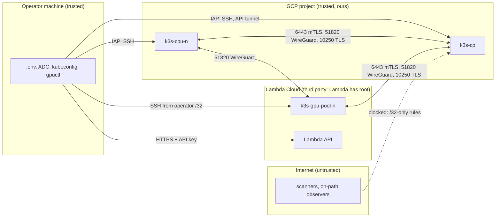

# Threat model

Scope: the cluster as built by this repository on `main`: `k3s-cp` and the CPU workers on GCP, GPU
workers on Lambda Cloud, the operator's machine that runs `make`, and the evidence committed under
`verification/`. The design rationale is in the [README](../README.md) and the ADRs; this document
lists what we protect, from whom, how, and what is left.

## Assets

| Asset | Where it lives | Impact if lost |
|---|---|---|
| Cluster-admin kubeconfig | operator: `~/.kube/hybrid-gpu.yaml` (0600, server `https://127.0.0.1:6443`); `k3s-cp`: `/etc/rancher/k3s/k3s.yaml` | full control of the cluster and every workload |
| k3s server token and cluster CA keys | `k3s-cp` only (`/var/lib/rancher/k3s/server`) | forge nodes and users; decrypt nothing on the wire, but sign anything |
| Join tokens | created per node on `k3s-cp` with `--ttl 15m`, piped to the node's `/etc/rancher/k3s/token` (0600), deleted when the node is Ready | join a rogue node while valid |
| Lambda API key | operator: `.env` (mode 600 enforced) | the whole Lambda account: launch (billing), terminate, firewall changes, SSH key registration |
| GCP credentials | operator: `gcloud` login and ADC | whatever the operator's IAM allows in the project |
| Terraform state | GCS bucket `<GCP_PROJECT>-k3s-tfstate` (versioned, uniform access, public access prevented); bootstrap state local | infrastructure map; no secrets are stored in it by these stacks |
| Workloads and their data | pods on all nodes; Secrets encrypted at rest in the datastore on `k3s-cp` | confidentiality and integrity of the hello and GPU workloads |
| GPU hosts | Lambda instances `k3s-gpu-<pool>-<n>` | a foothold inside the pod network; billing |
| The verification evidence | `verification/<ts>/` (git-ignored), `verification/final/` (committed) | leak of addresses or credentials if not redacted |

## Trust boundaries

1. **Internet ↔ every node.** All cluster traffic crosses it. Pod traffic is inside WireGuard;
   6443 and 10250 are TLS on the public path, admitted from peer `/32`s only.
2. **GCP project.** Ours. VMs have Shielded VM, OS Login, project SSH keys blocked, SSH only through
   IAP, service accounts with no IAM roles, `can_ip_forward = false`.
3. **Lambda Cloud.** A third party operates the hypervisor and has root on the GPU hosts; we control
   the OS from first boot onward only through SSH, and the network only through Lambda's firewall and
   our host table. Its API key is account-wide and cannot be scoped.
4. **Operator machine.** Holds every credential that can change infrastructure. Its compromise is out
   of scope for mitigation beyond file modes, but its blast radius is listed below.

## Threats and mitigations

| # | Threat | Mitigation | Evidence |
|---|---|---|---|
| T1 | Internet scan or exploit of the API server (6443) or a kubelet (10250) | Cloud rules admit only peer `/32`s; `k3s_guard` drops 6443/10250 from anything but `lo`, `cni0` and `k3s_peers` (cp) or `<cp_ip>` (agents); both require client certificates or kubelet authorisation | B5: 6443 and 10250 time out from the operator's machine; guard drop counters; B6 lists every rule |
| T2 | A cloud firewall rule opened to everyone by mistake (an empty source list) | Dynamic rules are `for_each` over the inventory, so `[]` creates none; single-IPv4 validation; the any-IPv4 CIDR is banned from the repository by a test; host table as a second layer | `infra/gpu-access/tests` (`empty_list_creates_no_rules`, `back_to_empty_removes_all_rules`); B6 |
| T3 | Eavesdropping or tampering with pod traffic between providers | flannel `wireguard-native` mesh, 25 s keepalive | B2: a marker sent between pods never appears in clear text on `k3s-cp`'s NIC; only udp/51820 carries pod traffic; B3 handshakes |
| T4 | Rogue node joins the cluster | Join tokens are CA-pinned (`K10…`), valid 15 minutes, never on disk or in an argument on the operator side, deleted after Ready; agents re-authenticate with their own certificate and node password; peers must also be in the allow-lists | `k3s token list` empty after joins (measured); agent restart after token deletion stays Ready (measured) |
| T5 | A node attracts GPU workloads or claims to be something it is not | GPU scheduling keys on `node-restriction.kubernetes.io/accelerator=nvidia`, which NodeRestriction forbids a kubelet to set; `join-node.sh` applies it with admin rights | D-group checks; [ADR-0005](adr/0005-gpu-device-plugin-and-runtimeclass.md) |
| T6 | A pod steals the GCE VM's service-account token from the metadata server | The service accounts have no IAM roles; `k3s_guard` drops pod traffic (`10.42.0.0/16`) to `169.254.169.254` except DNS on port 53 | B5: metadata request from a pod on a GCP node times out; DNS still works |
| T7 | Container escape or privilege abuse by a workload | PSA `restricted` on every namespace except `kube-system` (exempt) and `nvidia-device-plugin` (labelled `privileged`); the optional monitoring stack adds `monitoring-host`, privileged for the hostPath reads of node-exporter and the DCGM exporter; workloads run non-root with all capabilities dropped, no privilege escalation, seccomp `RuntimeDefault` and no service-account token mounted (`hello` and `nettest` also with a read-only root filesystem); default-deny ingress NetworkPolicy in `hello` | manifest tests in `tests/k8s`; C8 (allowed from `nettest`, rejected elsewhere) |
| T8 | Lambda API key leaks | Lives only in `.env` (mode 600 required, git-ignored); sent only as an HTTP header from `gpuctl`'s Python process, never on a command line, never re-sent on a redirect, masked in error text, removed from every child process's environment and unset by every script that does not need it; never on a node, in `user_data` or in Terraform; gitleaks rule for its prefix | `.gitleaks.toml`; `make lint` scans history; redaction tests |
| T9 | Secrets committed or published in evidence | gitleaks in pre-commit and `make lint` (full history and uncommitted changes) with custom rules for `K10` tokens and the Lambda key; every check's output passes a redaction filter (kubeconfig keys, tokens, passwords, private keys, the Lambda key), the operator's IP is masked as `<operator_ip>` and the GCP project id as `<GCP_PROJECT>` (in any case); `wg show` never with `dump`; each run is scanned by gitleaks; `make promote-verify` copies a run to a staging directory, scans every file again and fails on the GCP project id (the environment's and `.env`'s) before it replaces `verification/final/`. It fails on the operator's IP only when `OPERATOR_IP` is set in the caller's environment (it never looks the IP up), so the runbook passes it explicitly and requires a `grep` for the current IP over `verification/final/` before commit | `tests/test_gitleaks_rules.py`, `tests/scripts/test_promote.py`, `tests/scripts/test_checks_abc.py` (redaction) |
| T10 | Runaway cost: a GPU node left billing, or a launch loop | `budget_usd_per_hour` and `max_nodes` checked at live prices before any launch; failed joins are terminated; `make down` ends by asking Lambda that no GPU node is left and fails if one is | [ADR-0004](adr/0004-gpu-nodes-as-cattle-spec-reconciler.md); `tests/scripts/test_down.py` |
| T11 | An automated apply destroys the control plane or an undrained worker | Stacks split so `gpuctl`'s `-auto-approve` reaches only GPU rules; base and workers applies under `AUTO_APPROVE=1` refuse destroys (`--no-destroy`, `--destroy-only NAME`); unattended CPU scaling additionally passes the saved plan through `gpuctl tfguard` under a lock. Not covered: `make down` destroys every stack, `k3s-cp` included, after one question that `AUTO_APPROVE=1` in the caller's environment skips (`.env` cannot set it); the runbook says never to export it | [ADR-0003](adr/0003-terraform-three-stacks.md); `infra/*/tests`; `tests/scripts/test_cpu_pool_guarded.py` |
| T12 | Undrained node termination loses work silently | `gpuctl down/apply` refuse an undrained terminate while the cluster exists but the API is unreachable ("start make tunnel and re-run, or pass --no-drain") | `lambda/tests/test_down_unreachable.py` |
| T13 | The API is exposed on the operator's LAN | The tunnel binds loopback (`-L 6443:127.0.0.1:6443`) with `-o GatewayPorts=no`, which overrides any ssh config | `tests/scripts/test_ops_scripts.py` |
| T14 | Lambda services bypass the firewall (JupyterLab, Docker's FORWARD rules) | `lambda-jupyter` and Docker disabled by the GPU bootstrap; Lambda's global rules reduced to the operator's SSH `/32`; per-region rulesets attached at launch | Measured: JupyterLab unreachable (its proxied URL returns 502, direct 8888 times out); only tcp/22 from the operator answers |
| T15 | Malicious or compromised `.env` | `.env` is sourced as shell (`load_env`), so whoever can write it runs code as the operator; the file must be mode 600, and `make down` refuses a `.env` that touches its safety variables | Stated, not mitigated further: see residual risks |
| T16 | Supply chain: a changed installer or image | k3s `install.sh` from the release tag, never `get.k3s.io`; every image pinned by `@sha256:` digest; provider lock files with `-lockfile=readonly`; pre-commit hooks pinned by commit | `tests/k8s` digest checks; `tests/test_terraform_static.py` |

### Detection: what is observable today

- API server audit log on `k3s-cp` at `Metadata` level (no request bodies, so no Secret contents),
  30 days, 10 backups of 100 MB (`/var/lib/rancher/k3s/server/logs/audit.log`).
- GCP firewall rule logging (`log_config`) on every rule.
- `k3s_guard` counters on the accept and drop rules (read by B5).
- `/var/log/gpu-audit.txt` on each GPU node: the host as found, before any change.
- `gpuctl status`: drift between Lambda, the cluster, the `gpu-access` state and `k3s_peers`.
- metrics-server (`kubectl top`), and the evidence of every `make verify` run.

There is no central log store, no alerting and no long-term metrics; those are
[P2](p2-roadmap.md). GCP's managed Prometheus and Cloud Logging were not used: they need IAM roles on
the node service accounts and a credential on the Lambda hosts, which contradicts "service accounts
have no roles" and "no credentials on third-party hosts".

## Residual risks

| Risk | Why it remains | What would remove it |
|---|---|---|
| **6443 and 10250 cross the internet outside WireGuard** (the stated cost of option A) | Protected by TLS, client authentication and `/32` rules at two layers, but on-path observers see TLS metadata, and a TLS or authentication flaw in the API server or kubelet is reachable from any allowed peer address | Option B or C ([ADR-0002](adr/0002-network-k3s-wireguard-native.md)) |
| **containerd 2.3.4** bundled with k3s `v1.36.5+k3s1` is likely affected by two medium-severity image-pull DoS advisories (GHSA-vwhp-8p66-mq4f, GHSA-8647-2jxj-p2rc, 2026-10-13; fixed upstream in 2.3.7) | k3s pins its containerd; whether the fix was backported is not verified | Upgrade to a k3s release with the fix; images here are digest-pinned from known registries, which narrows the trigger |
| **Lambda has root on the GPU hosts** | Third-party hardware and hypervisor; the image is theirs | Nothing short of confidential computing; keep sensitive data off GPU nodes or encrypt it at the application layer |
| **IP forwarding on Lambda hosts (T-1)** | Pod traffic needs `net.ipv4.ip_forward=1` (`/etc/sysctl.d/90-kubelet.conf`; GCE's `60-gce-network-security.conf` sets 0 and broke pod traffic after `sysctl --system`, so ours sorts after it). With forwarding on, a host routes between all interfaces (FORWARD policy ACCEPT). On GCP, `can_ip_forward = false` drops packets with a foreign source or destination; Lambda has no NIC-level anti-spoofing. A host on the same L2 segment as a GPU node can therefore send traffic addressed to `10.42.0.0/16` or `10.43.0.0/16` through it: into `cni0` (that node's pods, both ways), into `flannel-wg` (pods on every other node, encrypted with the GPU node's own key, so the peers accept it as authentic), or through kube-proxy's DNAT to any ClusterIP Service, arriving as that node. This bypasses both allow-list layers (cloud firewall and `k3s_peers`); NetworkPolicy is the only remaining control, and in the core build only `hello` has a default-deny policy. Whether Lambda isolates tenants at L2 on its private `/20` is not verified | A `k3s_guard` forward rule that drops forwarded packets when neither side is a pod interface (`cni0`, `flannel-wg`); not in core because changing the guard reloads it on every node ([P2](p2-roadmap.md)). Meanwhile a default-deny NetworkPolicy in every namespace narrows it |
| **The kubeconfig is cluster-admin and shared** | k3s writes one admin kubeconfig; it is not tied to a person and has no expiry short of rotating the CA | Per-person client certificates or OIDC, RBAC per role ([P2](p2-roadmap.md)) |
| **Single control plane** | k3s's multicloud mode does not support embedded etcd; there is no automated backup of the datastore or the server token | Three servers with an external datastore, or another network design first; scheduled backups ([P2](p2-roadmap.md)) |
| **Lambda host keys are trusted on first use** | A new instance's SSH host key is unknown in advance; `ssh` uses `StrictHostKeyChecking=accept-new` with one `known_hosts` file per node, deleted with the node. A man in the middle on the first connection could impersonate the host and receive the join token | Fetch the host key through an authenticated channel (Lambda does not offer one), or have the node pull its token over a pinned TLS channel |
| **GPU visibility through the image environment** | Any pod under the `nvidia` handler whose image sets `NVIDIA_VISIBLE_DEVICES=all` sees all GPUs on the node | CDI mode and a ValidatingAdmissionPolicy restricting the RuntimeClass ([ADR-0005](adr/0005-gpu-device-plugin-and-runtimeclass.md)) |
| **The Lambda API key is account-wide** | Lambda keys cannot be scoped; anyone with the key controls every instance and firewall rule in the account | Rotation and a dedicated Lambda account for this cluster ([P2](p2-roadmap.md)) |
| **`.env` is executed as shell** | `load_env` sources it, so a writable `.env` is code execution as the operator, with the operator's GCP and Lambda credentials | Parse `KEY=VALUE` lines instead of sourcing; keep the file 600 and the checkout private |
| **IP identity** | A peer is admitted by address; a reused Lambda IP or a spoofing on-path attacker reaches the TLS endpoints (still without credentials) | Identity-based network ([ADR-0006](adr/0006-ip-allowlist-vs-identity-network.md)) |
| **Evidence redaction is pattern-based** | Redaction is line-based regular expressions (the operator IP and the GCP project id are masked as `<operator_ip>` and `<GCP_PROJECT>`), with gitleaks and the promote-time project-id and `OPERATOR_IP` checks as backstops; a secret in a format no pattern knows passes all of them, and the IP check depends on the operator setting `OPERATOR_IP` | Keep promoted evidence minimal and reviewed before commit |
| **No egress control** | Pods and nodes can reach the internet freely (needed for image pulls and apt) | Egress NetworkPolicy and an egress proxy ([P2](p2-roadmap.md)) |
